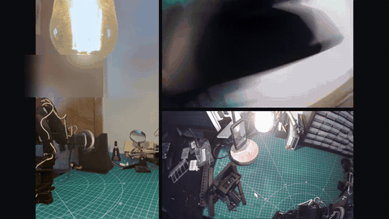
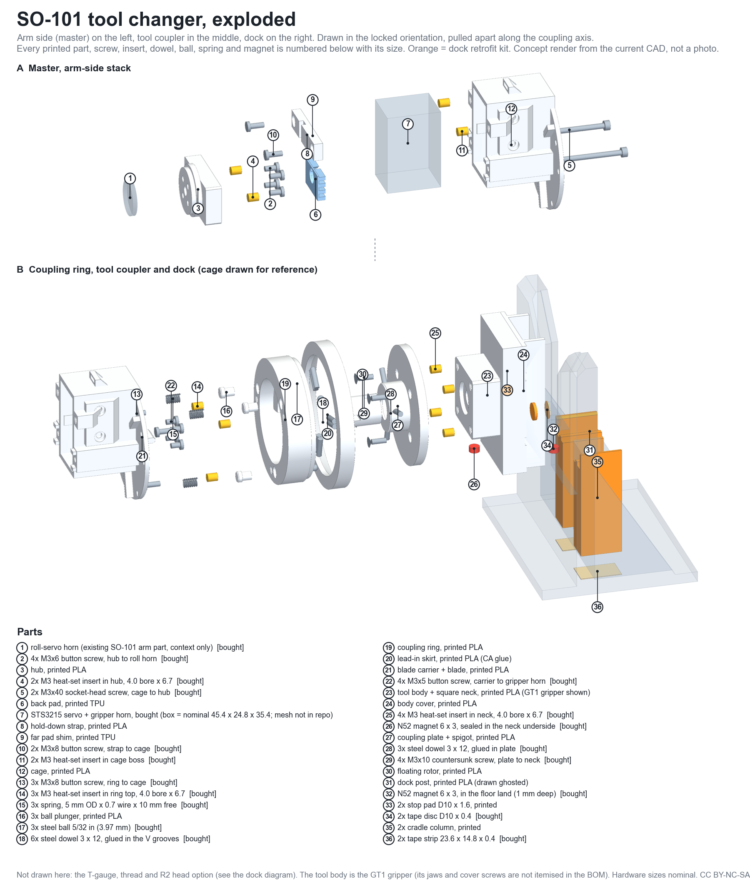
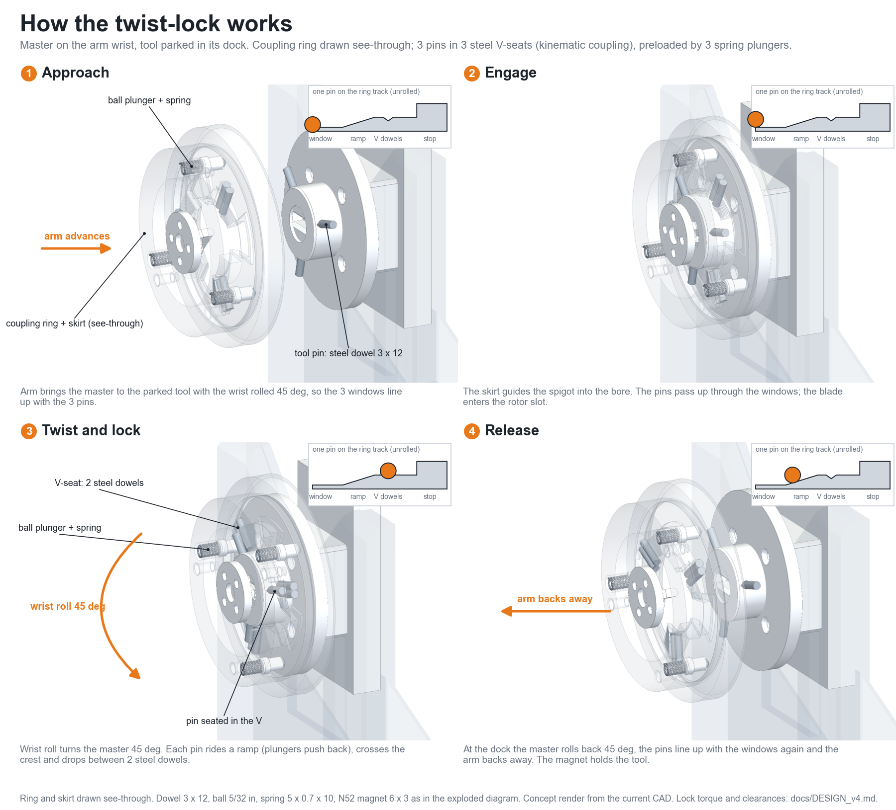
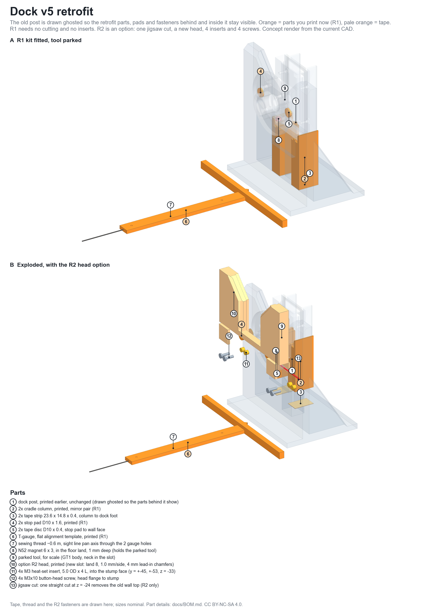

# SO-101 tool changer

Hardware: free for personal/non-commercial use (CC BY-NC-SA 4.0). Code: open source (GPL-3.0).
Commercial use of the hardware / kits: contact Logic Frame Co ([logicframeco.com](https://logicframeco.com)).

A tool changer for the SO-101 robot arm: a master on the wrist, a coupler on each tool, and docks on the bench. Parts are 3D printed with a few dowels, magnets, balls and springs. The control code drives the arm through LeRobot.

## Status
Work in progress: scripted locks achieved; no full automatic swap cycle yet. Scripted dock cycles and seat tests are logged; one lock was wiggle-verified by hand. 0 clean picks so far, and the lift-out from the dock still jams. Treat everything here as unproven design files.

*Manual swap: a person drives the arm (teleop) to pick up a tool from the dock, filmed from three cameras. Not automatic; no full automatic swap cycle yet.* (click for the full video)

## The changer
Exploded view of the master (arm side), the tool coupler and the dock, with every printed part, screw, insert, dowel, ball, spring and magnet numbered and sized. Concept render from the current CAD, not a photo.

([SVG version](docs/diagrams/changer_exploded.svg))

## How the twist-lock works
The master on the wrist locks onto the tool coupler with three pins in three steel V-seats (a kinematic coupling). The arm approaches with the wrist rolled 45 deg, the pins pass through three windows, then a 45 deg wrist roll drives each pin up a ramp (spring plungers with steel balls push the tool plate back), over a crest and into the V. A magnet pair keeps the parked tool from being dragged out of the dock. Release is the same motion in reverse.

([SVG version](docs/diagrams/twist_lock_sequence.svg))

## Dock
The v5 dock retrofit (stop pads, cradle columns, T-gauge and the R2 head option), drawn with the old post ghosted so the parts behind it show.

([SVG version](docs/diagrams/dock_v5_retrofit.svg))

## Video
**manual_swap_teleop_multicam.mp4**: Manual swap: a person drives the arm (hand-flown/teleop) to pick up a tool from the dock. Not automatic; no full automatic swap cycle yet. Three synced cameras (phone on the bench, wrist camera, overhead bench camera), mostly sped up, no sound.

Real bench takes, 10/28, scene camera, low-res. They are attached to the [media-2026-10-30 release](https://github.com/chaseab/so101-toolchanger/releases/tag/media-2026-10-30). Failures stay in.

No clip yet shows a lock clearly; the next bench session records every attempt.

**real_take1_hand_touch_arm_lifts.mp4**: Real bench take, 10/28, scene camera. A hand touches the tool body at the dock, then the arm jerks up and away. This session was hand-flown with the leader arm (teleop), not an automatic swap. Whether this was a lock or just contact is unclear, and the yellow blow-out is the camera exposure. Failures stay in.

**real_take2_swing_away.mp4**: Real bench take, 10/28, scene camera. The arm sits at the dock, then swings away and back. Scripted run, no cut and no sound. A lock is not visible here and the swing away may be a release, a jam or a test pull. The arm has done 0 full automatic swaps so far.

**real_take3_wrist_snap.mp4**: Real bench take, 10/28, scene camera. The wrist snaps over fast and a small black piece with a cable ends up on the mat. I am not claiming whether this run was hand-flown or scripted, and it is unclear whether the piece was dropped or let go. Not a clean swap. The arm has done 0 full automatic swaps so far.

## Bill of materials
**One tool changer (master + 1 tool coupler + 1 dock) = 20 printed parts (23 pieces, about 666 g) plus hardware.** Master 9 parts (11 pieces), tool coupler 3, dock 4 plus the 4-part R1 retrofit kit (5 pieces). Older versions, alternates, test coupons, the optional R2 dock head and the future tools are not counted. Full table with sizes, grams, filament, exact listings we bought and generic search links: [docs/BOM.md](docs/BOM.md) (and `docs/BOM.csv`). It has three sections: A one tool changer, B per extra tool, C optional and future.

Bought parts for one build:

| Part | Qty | Used for |
|---|---|---|
| Steel dowel pin 3 x 12 mm | 9 | arm-side V-seats (6), tool plate pins (3) |
| N52 magnet 6 x 3 mm | 2 | tool neck, dock floor |
| Chrome steel ball 5/32 in | 3 | plunger tips |
| Compression spring 5 x 0.7 x 10 mm | 3 | plungers |
| M3 x 10 countersunk screw | 8 | coupling plate (4), dock clamp bars (4) |
| M3 heat-set insert 4.0 x 6.7 | 15 | arm side 7, tool neck 4, dock frame 4 |
| M3 button-head screws (M3x5/6/8) | 13 | arm side |
| M3 x 40 socket screw | 2 | servo cage to hub |
| Double-sided tape discs / strips | 2 / 2 | dock R1 kit |
| PTFE grease, CA glue | 1 / 1 | assembly |

Each part, with its exact listing where we have one, is in [docs/BOM.md](docs/BOM.md).

## Build
- Print the 20 parts listed in section A of the BOM from `stl/` (`master_v4`, `tool_gt1`, `dock_v5`); the BOM lists material and grams per part. STEP files are in `step/`.
- Assemble with the hardware in the BOM: dowels glued into the ring's V grooves and the tool plate, ball plungers with springs, heat-set inserts, M3 screws, and one N52 6 x 3 magnet in the tool neck and one in the dock floor.
- The dock retrofit kit (R1) prints with no cutting; the R2 head needs one jigsaw cut. See `docs/diagrams/dock_v5_retrofit.png`.
- Design notes, lock-torque numbers and test results: `docs/DESIGN_v4.md`; bench procedure: `docs/RUNBOOK.html`.

## Folder map
- `cad/` CAD-as-code (build123d) for the master, docks and gripper tool, plus `cad/heads/` and `cad/tools/` for the future tools. Interference and lock-path checks are here too.
- `stl/`, `step/` exported meshes of the current parts: `master_v4`, `dock_v5`, `tool_gt1`, plus `heads_*` and `tool_fr1` for the future tools.
- `swap/` arm control and test code (capguard, jog, real_io, dockcycle, pick2, fakebus/sim_io, tests).
- `sim/` MuJoCo contact model used by the sim twin.
- `docs/` design notes (`DESIGN_v4.md`), runbook, `BOM.md` / `BOM.csv`, `diagrams/`, and `future_tools/` (concept tools, not the focus yet).
- `LICENSES/` license texts. `NOTICE` upstream credits.

Not included: SO-ARM100 / Feetech servo meshes (get them upstream), calibration files, logs, footage, print files (gcode/3mf).
Some swap/ scripts import modules that live outside this repo (`splat`, `grip_cap`) and `swap/capture.py` (camera capture used by capguard) is not included; they will not run unmodified. Paths and serials were scrubbed; set `TC_PYTHON`, `TC_CAPTURE_OUT` as needed.

## Licenses (split)
| What | Where | License |
|---|---|---|
| Hardware, CAD source, STEP/STL, docs | `cad/`, `stl/`, `step/`, `docs/`, this README | CC BY-NC-SA 4.0 |
| Code | `swap/`, `sim/` | GPL-3.0-or-later |

Full texts are in `LICENSES/`. The hardware, CAD, STEP/STL and docs are for personal and non-commercial use only; selling kits or parts, or using them in a commercial product, needs written permission from Logic Frame Co. The code is GPL-3.0-or-later. No file in this repo is upstream code or geometry, so no file here is relabeled; upstream Apache-2.0 work is credited in `NOTICE` and is not redistributed.

Upstream Apache-2.0 work (TheRobotStudio SO-ARM100, Hugging Face LeRobot) is credited in `NOTICE`. SO-101 is a TheRobotStudio design; this project is not affiliated. Provided as-is.

(c) 2026 Chase Bonfiglio / Logic Frame Co. If you build or adapt this, please credit Chase Bonfiglio / Logic Frame Co and link back to this repo.
