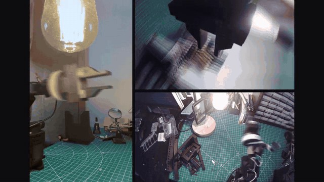
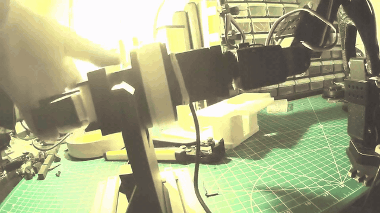
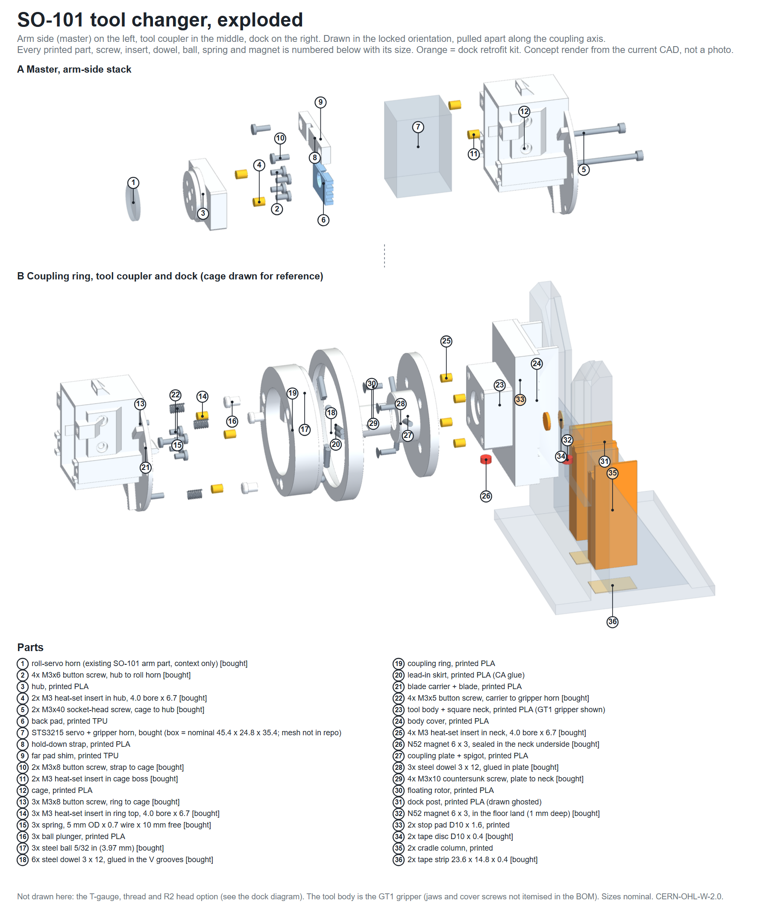
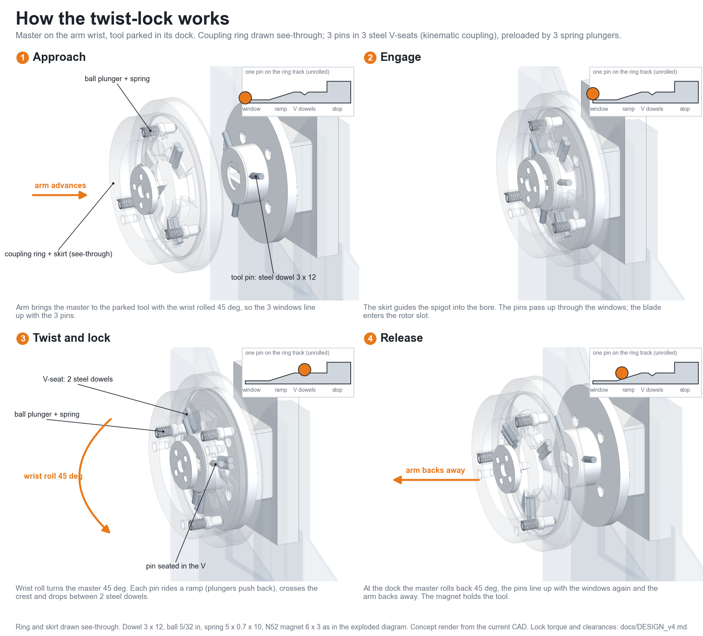
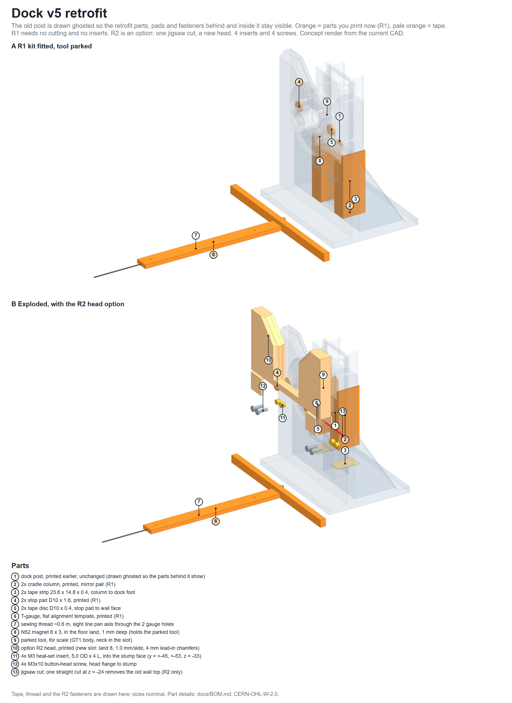
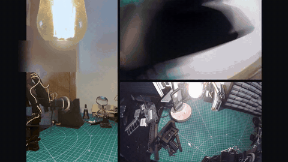

# SO-101 tool changer

Open source hardware: CERN-OHL-W-2.0 (hardware), GPL-3.0-or-later (code), CC BY 4.0 (docs and data).

A tool changer for the SO-101 robot arm: a master on the wrist, a coupler on each tool, and docks on the bench. Parts are 3D printed with a few dowels, magnets, balls and springs. The control code drives the arm through LeRobot.

| | |
|---|---|
|  |  |
| *Manual swap (teleop): a person drives the arm.* | *Real bench take, 10/28, teleop session: a hand touches the tool at the dock, then the arm lifts away. Unclear whether it locked.* |

Project page: [logicframeco.com/tool-changer](https://logicframeco.com/tool-changer)

## Status
**Status (Nov 3, 2026):** scripted, automatic pick and put-back cycles work at one known dock pose (tool GT1 on the v4 coupling, one SO-101, scripted controller, no learned policy). On Nov 2 a 100-cycle run gave 100/100 picks locked on the first try, each passing a wiggle test, and 99/100 put-backs; 199 of 200 dock operations completed. The one abort was a false servo temperature reading (the elbow read 56 C, then 150 C, while its real temperature was about 47 C); the watchdog stopped the arm and the run was resumed. There were 0 docking failures. Median cycle 29.6 s (pick + put-back). Three short runs just before it were stopped (operator stop before recording; dock camera misconfigured; one false temperature reading); they are logged too. Earlier the same day: 10 cycles in a row, with 3 failed attempts (short push into the seat) before that streak. Raw logs and a column dictionary are in [`data/`](data/). Not yet shown: a moved or rotated dock, other tools, other arms, or a learned policy.

https://github.com/user-attachments/assets/b7d32b12-1a1b-4e72-bdfa-cfc6b35f867a

*Manual swap (Oct 30): a person drives the arm (teleop) to pick up a tool from the dock, filmed from three cameras. Not the automatic cycle.*

## The changer
Exploded view of the master (arm side), the tool coupler and the dock, with every printed part, screw, insert, dowel, ball, spring and magnet numbered and sized. Concept render from the current CAD, not a photo.

([SVG version](docs/diagrams/changer_exploded.svg))

## How the twist-lock works
The master on the wrist locks onto the tool coupler with three pins in three steel V-seats (a kinematic coupling). The arm approaches with the wrist rolled 45 deg, the pins pass through three windows, then a 45 deg wrist roll drives each pin up a ramp (spring plungers with steel balls push the tool plate back), over a crest and into the V. A magnet pair keeps the parked tool from being dragged out of the dock. Release is the same motion in reverse.

([SVG version](docs/diagrams/twist_lock_sequence.svg))

## Dock
The v5 dock retrofit (stop pads, cradle columns, T-gauge and the R2 head option), drawn with the old post ghosted so the parts behind it show.

([SVG version](docs/diagrams/dock_v5_retrofit.svg))

## Video

**manual_swap_teleop_multicam.mp4**: Manual swap: a person drives the arm (hand-flown/teleop) to pick up a tool from the dock. Not the automatic cycle. Three synced cameras (phone on the bench, wrist camera, overhead bench camera), mostly sped up, no sound.

Real bench takes, 10/28, scene camera, low-res. They are attached to the [media-2026-10-30 release](https://github.com/chaseab/so101-toolchanger/releases/tag/media-2026-10-30). Failures stay in.

These takes are from Oct 28, before the scripted cycle worked; none of them shows a lock clearly.

**real_take1_hand_touch_arm_lifts.mp4**: Real bench take, 10/28, scene camera. A hand touches the tool body at the dock, then the arm jerks up and away. This session was hand-flown with the leader arm (teleop), not an automatic swap. Whether this was a lock or just contact is unclear, and the yellow blow-out is the camera exposure. Failures stay in.

**real_take2_swing_away.mp4**: Real bench take, 10/28, scene camera. The arm sits at the dock, then swings away and back. Scripted run, no cut and no sound. A lock is not visible here and the swing away may be a release, a jam or a test pull. (Oct 28, before the first automatic swap.)

**real_take3_wrist_snap.mp4**: Real bench take, 10/28, scene camera. The wrist snaps over fast and a small black piece with a cable ends up on the mat. I am not claiming whether this run was hand-flown or scripted, and it is unclear whether the piece was dropped or let go. Not a clean swap. (Oct 28, before the first automatic swap.)

## Bill of materials
**One tool changer (master + 1 tool coupler + 1 dock) = 20 printed parts (23 pieces, about 666 g) plus hardware.** Master 9 parts (11 pieces), tool coupler 3, dock 4 plus the 4-part R1 retrofit kit (5 pieces). Older versions, alternates, test coupons, the optional R2 dock head and the future tools are not counted. Full table with sizes, grams, filament, exact listings we bought and generic search links: [docs/BOM.md](docs/BOM.md) (and `docs/BOM.csv`). It has three sections: A one tool changer, B per extra tool, C optional and future.

Bought parts for one build:

| Part | Qty | Used for |
|---|---|---|
| Steel dowel pin 3 x 12 mm | 9 | arm-side V-seats (6), tool plate pins (3) |
| N52 magnet 6 x 3 mm | 2 | tool neck, dock floor |
| Chrome steel ball 5/32 in | 3 | plunger tips |
| Compression spring 5 x 0.7 x 10 mm | 3 | plungers |
| M3 x 10 countersunk screw | 8 | coupling plate (4), dock clamp bars (4) |
| M3 heat-set insert 4.0 x 6.7 | 15 | arm side 7, tool neck 4, dock frame 4 |
| M3 button-head screws (M3x5/6/8) | 13 | arm side |
| M3 x 40 socket screw | 2 | servo cage to hub |
| Double-sided tape discs / strips | 2 / 2 | dock R1 kit |
| PTFE grease, CA glue | 1 / 1 | assembly |

Each part, with its exact listing where we have one, is in [docs/BOM.md](docs/BOM.md).

## Build
- Print the 20 parts listed in section A of the BOM from `stl/` (`master_v4`, `tool_gt1`, `dock_v5`); the BOM lists material and grams per part. STEP files are in `step/`.
- Assemble with the hardware in the BOM: dowels glued into the ring's V grooves and the tool plate, ball plungers with springs, heat-set inserts, M3 screws, and one N52 6 x 3 magnet in the tool neck and one in the dock floor.
- The dock retrofit kit (R1) prints with no cutting; the R2 head needs one jigsaw cut. See `docs/diagrams/dock_v5_retrofit.png`.
- Design notes, lock-torque numbers and test results: `docs/DESIGN_v4.md`; bench procedure: `docs/RUNBOOK.html`.

## Folder map
- `cad/` CAD-as-code (build123d) for the master, docks and gripper tool, plus `cad/heads/` and `cad/tools/` for the future tools. Interference and lock-path checks are here too.
- `stl/`, `step/` exported meshes of the current parts: `master_v4`, `dock_v5`, `tool_gt1`, plus `heads_*` and `tool_fr1` for the future tools.
- `swap/` arm control and test code (capguard, jog, real_io, dockcycle, pick2, fakebus/sim_io, tests).
- `sim/` MuJoCo contact model used by the sim twin.
- `docs/` design notes (`DESIGN_v4.md`), runbook, `BOM.md` / `BOM.csv`, `diagrams/`, and `future_tools/`.
- `data/` raw trial logs (100-cycle run, Nov 2) with a column dictionary.

**Out of scope / experimental:** the future tool heads `hi5f`, `jg2`, `stamp2` and the fin-ray tool `fr1` (`cad/heads/`, `cad/tools/`, `stl/heads_*`, `stl/tool_fr1`, `docs/future_tools/`) are unbuilt or untested concepts. None of the results above uses them.
- `LICENSES/` license texts. `NOTICE` upstream credits.

Not included: SO-ARM100 / Feetech servo meshes (get them upstream), calibration files, footage, print files (gcode/3mf). Trial logs are in `data/`.
**Missing dependencies:** some `swap/` scripts import modules that are not in this repo (`splat`, `grip_cap`, and `swap/capture.py`, the camera capture used by capguard), so they will not run unmodified. The scripted P11 cycle runner that produced the Nov 2 results (`cycle.py`, `nudge.py`, `programs.py`) is not published here yet. Paths and serials were scrubbed; set `TC_PYTHON`, `TC_CAPTURE_OUT` as needed.

## Licenses
| What | Where | License |
|---|---|---|
| Hardware: CAD source, STEP/STL, drawings | `cad/`, `stl/`, `step/`, `docs/diagrams/` | CERN-OHL-W-2.0 |
| Code | `swap/`, `sim/` | GPL-3.0-or-later |
| Documentation and data | `docs/` (text), `data/`, this README | CC BY 4.0 |

Full texts are in `LICENSES/`. The hardware is open source hardware under the CERN Open Hardware Licence v2, weakly reciprocal: you may study, modify, make and sell it, including commercially, as long as you share your changes to these design files under the same licence and keep the source location (this repo). No file in this repo is upstream code or geometry, so no file here is relabeled; upstream Apache-2.0 work is credited in `NOTICE` and is not redistributed.

Upstream Apache-2.0 work (TheRobotStudio SO-ARM100, Hugging Face LeRobot) is credited in `NOTICE`. SO-101 is a TheRobotStudio design; this project is not affiliated. Provided as-is.

(c) 2026 Chase Bonfiglio / Logic Frame Co. If you build or adapt this, please credit Chase Bonfiglio / Logic Frame Co and link back to this repo.
