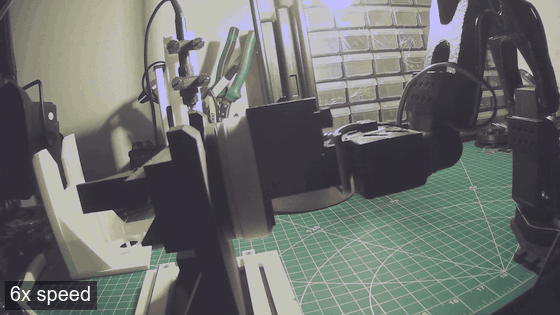

# SO-101 tool changer

Open source hardware: CERN-OHL-W-2.0 (hardware), GPL-3.0-or-later (code), CC BY 4.0 (docs and data).

A tool changer for the SO-101 robot arm: a master on the wrist, a coupler on each tool, and docks on the bench. Parts are 3D printed with a few dowels, magnets, balls and springs. The control code drives the arm through LeRobot.

*Automatic pick, wiggle check and put-back at the dock, 6x speed (Nov 5, scene camera). Pick + put-back take 14.7 s of real time; the clip also includes the wiggle check.*

Project page: [logicframeco.com/tool-changer](https://logicframeco.com/tool-changer)

## Status
- **100-cycle run (Nov 2):** 100/100 picks locked on the first try, each passing a wiggle test, and 99/100 put-backs, all automatic. The other put-back was stopped by a false servo temperature reading. Median cycle 29.6 s. Raw logs and a column dictionary are in [`data/`](data/).
- **Speed (Nov 5):** pick + put-back in 14.7 s over 4 runs, about half the Nov 2 time. The smooth-motion runner takes a free-air move in 9.4 s against 15.4 s for the stepped runner, with lower lift error and motor load.
- **FR1 fin-ray gripper tool:** built and working on the changer. It sits in its own dock, and the arm picks it up, checks the lock and puts it back.
- **Automatic dock finding (`find_dock2`):** the arm measures where the dock is by touch (a bracket of contacts across the dock, then the lip) and works out the pick pose from that. First live measurement of the dock Nov 8; finding a moved dock is the next test.
- **Off-angle seating:** on Nov 7 the master seated and locked with the gripper blade 30 deg off the tool rotor; the lead-in turned the rotor into place.

Tested on one SO-101 with a scripted controller (no learned policy).

## The changer
Exploded view of the master (arm side), the tool coupler and the dock, with every printed part, screw, insert, dowel, ball, spring and magnet numbered and sized. Concept render from the current CAD, not a photo.

([SVG version](docs/diagrams/changer_exploded.svg))

## How the twist-lock works
The master on the wrist locks onto the tool coupler with three pins in three steel V-seats (a kinematic coupling). The arm approaches with the wrist rolled 45 deg, the pins pass through three windows, then a 45 deg wrist roll drives each pin up a ramp (spring plungers with steel balls push the tool plate back), over a crest and into the V. A magnet in the tool neck helps hold the parked tool in the dock. The dock has a matching pocket for an optional second magnet; the current build runs without it. Release is the same motion in reverse.

([SVG version](docs/diagrams/twist_lock_sequence.svg))

## Dock
The v5 dock retrofit (stop pads, cradle columns, T-gauge and the R2 head option), drawn with the old post ghosted so the parts behind it show.

([SVG version](docs/diagrams/dock_v5_retrofit.svg))

## Earlier footage

Oct 30: a person drives the arm (teleop) to pick up a tool from the dock, three synced cameras, mostly sped up, no sound. [Video](https://github.com/chaseab/so101-toolchanger/releases/download/media-2026-10-30/manual_swap_teleop_multicam.mp4).

## Bill of materials
**One tool changer (master + 1 tool coupler + 1 dock) = 20 printed parts (23 pieces, about 666 g) plus hardware.** Master 9 parts (11 pieces), tool coupler 3, dock 4 plus the 4-part R1 retrofit kit (5 pieces). Older versions, alternates, test coupons, the optional R2 dock head and the future tools are not counted. Full table with sizes, grams, filament, exact listings we bought and generic search links: [docs/BOM.md](docs/BOM.md) (and `docs/BOM.csv`). It has three sections: A one tool changer, B per extra tool, C optional and future.

Bought parts for one build:

| Part | Qty | Used for |
|---|---|---|
| Steel dowel pin 3 x 12 mm | 9 | arm-side V-seats (6), tool plate pins (3) |
| N52 magnet 6 x 3 mm | 1 (+1 optional) | tool neck (dock-floor pocket optional, empty in the tested build) |
| Chrome steel ball 5/32 in | 3 | plunger tips |
| Compression spring 5 x 0.7 x 10 mm | 3 | plungers |
| M3 x 10 countersunk screw | 8 | coupling plate (4), dock clamp bars (4) |
| M3 heat-set insert 4.0 x 6.7 | 15 | arm side 7, tool neck 4, dock frame 4 |
| M3 button-head screws (M3x5/6/8) | 13 | arm side |
| M3 x 40 socket screw | 2 | servo cage to hub |
| Double-sided tape discs / strips | 2 / 2 | dock R1 kit |
| PTFE grease, CA glue | 1 / 1 | assembly |

Each part, with its exact listing where we have one, is in [docs/BOM.md](docs/BOM.md).

## Build
- Print the 20 parts listed in section A of the BOM from `stl/` (`master_v4`, `tool_gt1`, `dock_v5`); the BOM lists material and grams per part. STEP files are in `step/`.
- Assemble with the hardware in the BOM: dowels glued into the ring's V grooves and the tool plate, ball plungers with springs, heat-set inserts, M3 screws, and one N52 6 x 3 magnet in the tool neck (the dock-floor pocket is optional and empty in the tested build).
- The dock retrofit kit (R1) prints with no cutting; the R2 head needs one jigsaw cut. See `docs/diagrams/dock_v5_retrofit.png`.
- Design notes, lock-torque numbers and test results: `docs/DESIGN_v4.md`; bench procedure: `docs/RUNBOOK.html`.

## Run the scripted cycle
The runner that produced the Nov 2 100-cycle results is in `swap/` (controller `nudge_web.py`, runner `cycle.py`, program registry `programs.py`, paths in `swap/paths/` and `swap/programs/P11/`). It is the version used for runs `c1102_205018` / `c1102_215723`; [`swap/RUNNER.md`](swap/RUNNER.md) lists the small differences (temperature filter v1 vs v2) and what was removed for publication.

1. `cd swap && cp config.example.json config.json`, then set `port`, `capture_dir` and `calibration` (your LeRobot follower calibration).
2. `mkdir logs refs`, then start the controller in its own terminal: `python -u nudge_web.py` (no motion on start).
3. With the tool docked and the arm at its ready pose: `python programs.py run P11 100 --wiggle --fresh-refs --profile fast --rest-above 51`.
4. To stop, create a file named `STOP` in `swap/` (the arm freezes and holds) or press Ctrl-C.

`TC_FAKE_BUS=1` runs everything on a simulated bus for dry runs. The P11 paths are taught for one dock pose on one bench: re-teach them before running on another setup.

## Folder map
- `cad/` CAD-as-code (build123d) for the master, docks and gripper tool, plus `cad/heads/` and `cad/tools/` for the future tools. Interference and lock-path checks are here too.
- `stl/`, `step/` exported meshes of the current parts: `master_v4`, `dock_v5`, `tool_gt1`, plus `heads_*` and `tool_fr1` for the future tools.
- `swap/` arm control and test code: the P11 cycle runner (`nudge_web.py`, `cycle.py`, `programs.py`, see `swap/RUNNER.md`), plus earlier tools (capguard, jog, real_io, dockcycle, pick2, fakebus/sim_io, tests).
- `sim/` MuJoCo contact model used by the sim twin.
- `docs/` design notes (`DESIGN_v4.md`), runbook, `BOM.md` / `BOM.csv`, `diagrams/`, and `future_tools/`.
- `data/` raw trial logs (100-cycle run, Nov 2) with a column dictionary.

**Other tools:** `fr1` (fin-ray gripper, `cad/tools/`, `stl/tool_fr1`) is built and runs on the changer. The heads `hi5f`, `jg2` and `stamp2` (`cad/heads/`, `stl/heads_*`) are designs only. `docs/future_tools/` has renders of all four.
- `LICENSES/` license texts. `NOTICE` upstream credits.

Not included: SO-ARM100 / Feetech servo meshes (get them upstream), calibration files, footage, print files (gcode/3mf). Trial logs are in `data/`.
**Dependencies:** `splat/` (SO-101 kinematics) and `grip_cap.py` are now vendored in `swap/`. Still missing: `robust_teleop` (LeRobot bus retry patch, used only by `tc_teleop.py` and `splat/sweep.py`'s `connect_real`), MuJoCo for `sim_io.py`, and the `qtraj` trajectory player (hand-handoff and expressive moves only). Machine-specific settings (serial port, capture folder, calibration file) live in `swap/config.json`; copy `swap/config.example.json` to start.

## Licenses
| What | Where | License |
|---|---|---|
| Hardware: CAD source, STEP/STL, drawings | `cad/`, `stl/`, `step/`, `docs/diagrams/` | CERN-OHL-W-2.0 |
| Code | `swap/`, `sim/` | GPL-3.0-or-later |
| Documentation and data | `docs/` (text), `data/`, this README | CC BY 4.0 |

Full texts are in `LICENSES/`. The hardware is open source hardware under the CERN Open Hardware Licence v2, weakly reciprocal: you may study, modify, make and sell it, including commercially, as long as you share your changes to these design files under the same licence and keep the source location (this repo). No file in this repo is upstream code or geometry, so no file here is relabeled; upstream Apache-2.0 work is credited in `NOTICE` and is not redistributed.

Upstream Apache-2.0 work (TheRobotStudio SO-ARM100, Hugging Face LeRobot) is credited in `NOTICE`. SO-101 is a TheRobotStudio design; this project is not affiliated. Provided as-is.

(c) 2026 Chase Bonfiglio / Logic Frame Co. If you build or adapt this, please credit Chase Bonfiglio / Logic Frame Co and link back to this repo.
