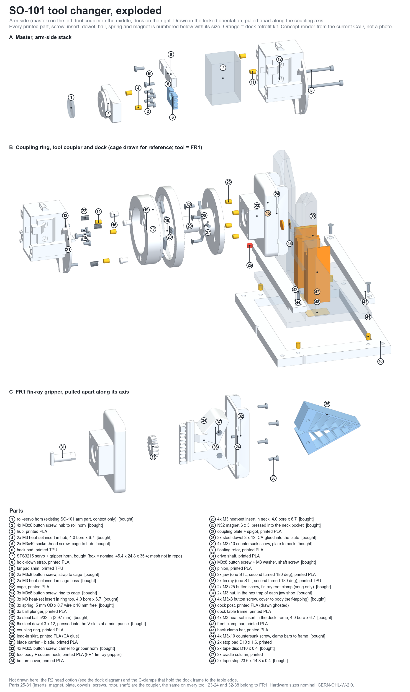
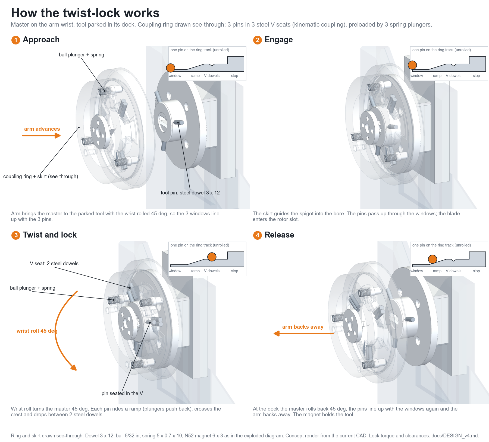
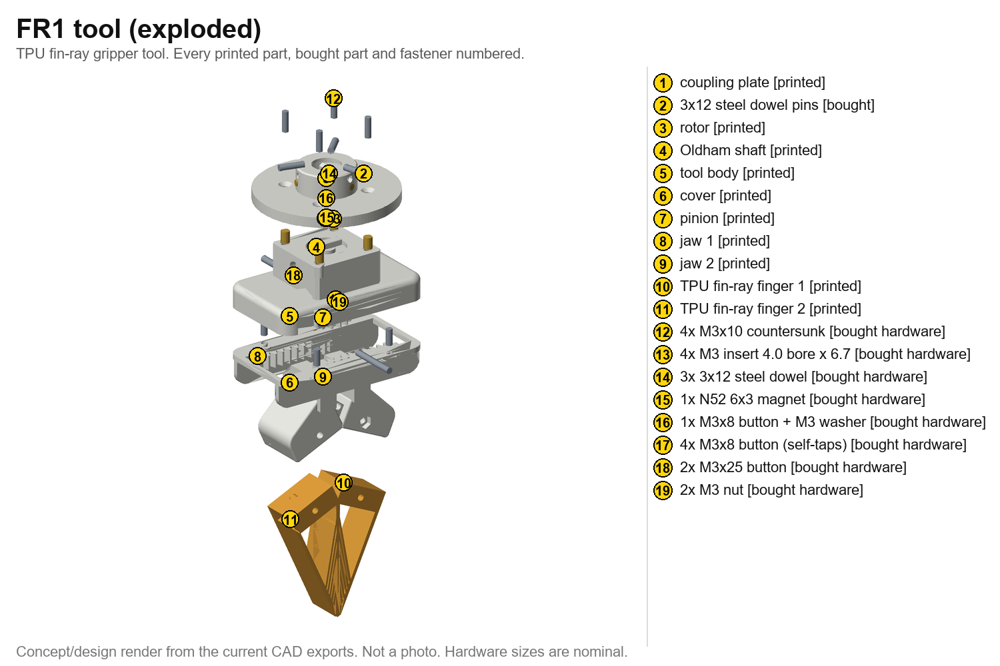
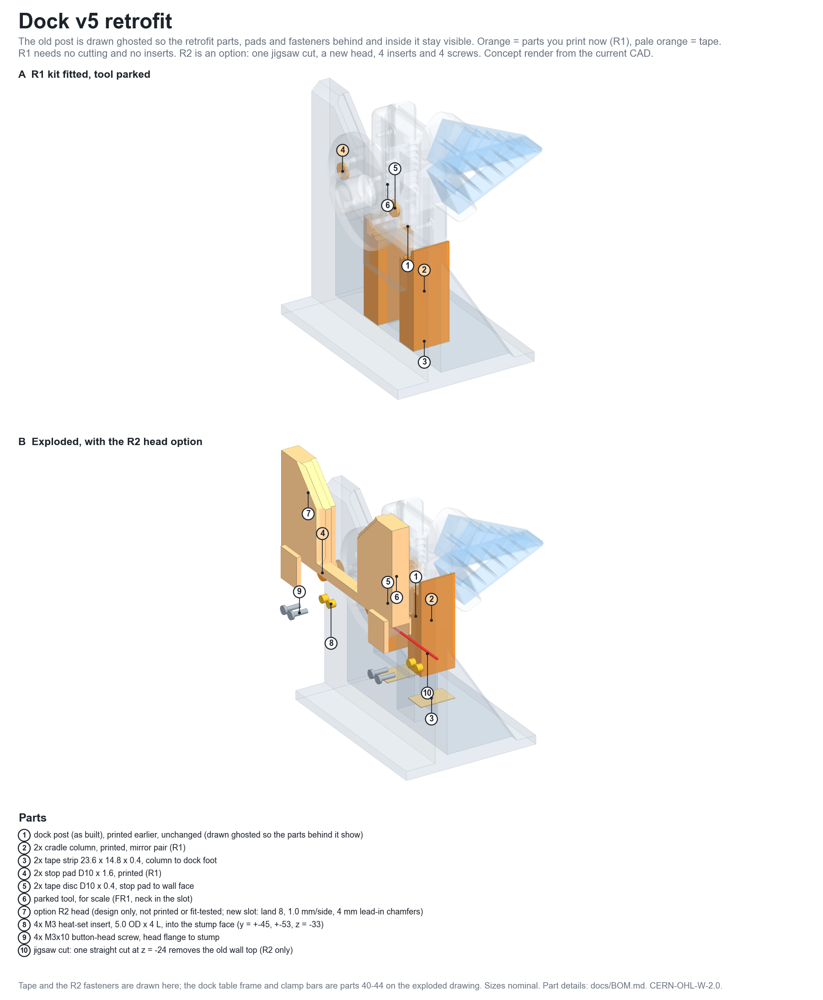

# Build notes

How to print and put together one tool changer: the master on the arm, one tool (the FR1 fin-ray gripper) and one dock. Part and screw numbers in brackets, like (#19), are the callouts on the exploded drawing below. Quantities and buy links are in [BOM.md](BOM.md).

## 1. What you need

- **Printed parts:** BOM section A (master, tool coupler, dock, R1 dock kit) and section D (FR1 tool). About 666 g of PLA for section A plus ~113 g for FR1, and a few grams of TPU 95A.
- **Bought parts:** 9 steel dowels 3 x 12, 3 steel balls 5/32 in, 3 springs 5 x 0.7 x 10, 15 M3 heat-set inserts (4.0 bore x 6.7), 1 N52 magnet 6 x 3, M3 screws (table below), double-sided tape, PTFE grease, CA gel.
- **Tools:** 2 mm and 2.5 mm hex keys, a soldering iron for the inserts (a printed stand keeps the iron straight), flush cutters, a printer that also prints TPU.
- **An SO-101 follower arm.** The master replaces the stock gripper body; the gripper servo moves into the master's cage.

## 2. Print

All parts were printed on a Bambu P1S, 0.4 mm nozzle, textured PEI plate.

| | PLA parts | TPU parts (fin rays, 2 small pads) | R1 dock kit |
|---|---|---|---|
| Layer height | 0.2 mm | 0.2 mm | 0.2 mm |
| Walls | 4 | 3 | 3 |
| Infill | 40 % gyroid | 100 % | 20 % gyroid |
| Top / bottom layers | 5 / 4 | 4 / 4 | 5 / 4 |
| Nozzle / bed | 220 / 55 °C | 225 / 35 °C | 220 / 55 °C |
| Supports | none, except the FR1 plate (tree, build plate only) | none | none |

The STLs are saved in the assembled position, not lying on the bed. Orient them like this ("as saved" = the file's +Z up; "flip" = turn upside down, 180° about X):

| File | Qty | On the bed | Notes |
|---|---|---|---|
| `stl/master_v4/master_hub_v4.stl` | 1 | as saved (horn face up) | |
| `stl/master_v4/master_cage_v4.stl` | 1 | as saved | |
| `stl/master_v4/master_strap_v4.stl` | 1 | as saved (flat) | |
| `stl/master_v4/master_carrier_v4.stl` | 1 | flip | |
| `stl/master_v4/master_ring_v4q.stl` | 1 | as saved | **pause after the layer at Z 6.0 mm** and drop the 6 dowels into the V slots, then resume |
| `stl/master_v4/master_skirt_v4.stl` | 1 | as saved | |
| `stl/master_v4/master_plunger0_v4b.stl` | 3 (+3 spare) | flip (head down) | the plunger1/2 files are the same part at the other seats; print a group of 6, small parts print better together |
| `stl/master_v4/master_backpad_TPU_v4.stl` | 1 | flip | TPU (a PLA version is in the folder) |
| `stl/master_v4/master_farpad_TPU_v4.stl` | 1 | flip | TPU (a PLA version is in the folder) |
| `stl/tool_fr1/plate.stl` | 1 | as saved | tool coupler, same on every tool |
| `stl/tool_fr1/rotor.stl` | 1 | as saved | tool coupler |
| `stl/tool_fr1/shaft.stl` | 1 | flip | tool coupler |
| `stl/tool_fr1/body.stl` | 1 | as saved (neck up) | |
| `stl/tool_fr1/cover.stl` | 1 | flip | |
| `stl/tool_fr1/pinion.stl` | 1 | as saved | |
| `stl/tool_fr1/jaw1.stl` | 2 | flip (rack face down) | the second jaw is the same file |
| `stl/tool_fr1/finray1.stl` | 2 | lying on its side (90° about X) | TPU 95A, no brim |
| `stl/dock_v5/dock_post_asbuilt.stl` | 1 | as saved (foot down) | 140 mm tall: use an outer brim. (to confirm: `stl/master_v4/dock_post_v4.stl` is a later version with a sealed magnet pocket and a print pause; which post was on the dock for the Nov 2 run is still to confirm) |
| `stl/master_v4/db_frame.stl` | 1 | as saved | |
| `stl/master_v4/db_bar_front.stl`, `db_bar_back.stl` | 1 each | flip | |
| `stl/dock_v5/cradle_col_L.stl`, `cradle_col_R.stl` | 1 each | as saved | R1 kit |
| `stl/dock_v5/stop_pad.stl` | 2 | on its edge (90° about Y) | R1 kit |
| `stl/dock_v5/t_gauge.stl` | 1 | as saved (flat) | R1 kit, one-time alignment template |

Don't print `master_dowels_v4.stl`, `tool_fr1/pins.stl` or `tool_gt1/gt_pins.stl`: those are the steel dowels, shown for reference. `stl/tool_gt1/` is the earlier gripper and `stl/heads_*` are designs.

## 3. Heat-set inserts

All 15 are M3, 4.0 mm bore x 6.7 mm long. Press each one in square with the soldering iron and let it sit flush. The master's bores have a small relief at the mouth so the melt doesn't lift the face.

| Part | Inserts | Side |
|---|---|---|
| Coupling ring (#14) | 3 | top face, one beside each spring pocket |
| Cage, strap bosses (#11) | 2 | from the top |
| Hub (#4) | 2 | mouth down |
| Tool neck (FR1 body) (#25) | 4 | neck face |
| Dock frame | 4 | under the clamp bars |

## 4. Fasteners

Every screw is M3.

| Screw | Qty | Where | Key |
|---|---|---|---|
| M3 x 6 button head (#2) | 4 | hub to the arm's wrist-roll horn | 2 mm |
| M3 x 5 button head (#22) | 4 | blade carrier to the gripper servo horn | 2 mm |
| M3 x 8 button head (#10, #13) | 5 | strap to cage (2), cage floor to ring (3) | 2 mm |
| M3 x 40 socket head (#5) | 2 | up through the cage ears into the hub | 2.5 mm |
| M3 x 10 countersunk (#29) | 4 | coupling plate to the tool neck | 2 mm |
| M3 x 10 countersunk | 4 | dock clamp bars to the dock frame | 2 mm |
| M3 x 8 button head + M3 washer | 1 | FR1 shaft screw | 2 mm |
| M3 x 8 button head | 4 | FR1 cover to body (self-tapping) | 2 mm |
| M3 x 25 button head + M3 nut | 2 | FR1: clamps each fin ray's root in its jaw | 2 mm |

Nothing on the master threads into bare plastic: every screw that carries the spring load goes into brass or into a servo horn.

## 5. Master (arm side)

The order below comes from the CAD notes (to confirm against the built arm).

1. **Ring.** The 6 dowels (#18) went in at the print pause. If you printed without the pause, glue them into the V grooves with CA gel, fully seated.
2. **Plungers.** CA one steel ball (#17) into the cup of each printed plunger (#16). Drop a spring (#15) and then a plunger into each of the ring's 3 pockets.
3. **Hub.** Take the stock gripper parts off the wrist-roll horn. Screw the hub (#3) onto the horn with 4x M3 x 6 from below, through the deep wells; this is done on the bench before the servo goes in, because the servo covers the wells.
4. **Servo into the cage.** Seat the gripper servo (#7) in the cage (#12) with the TPU back pad (#6) at the near end. Put the TPU shim (#9) over the far end, then the strap (#8), and screw the strap down with 2x M3 x 8 into the cage-boss inserts. Plug the servo cable in; the hub has a plug well beside it.
5. **Blade carrier.** Screw the carrier (#21) onto the gripper servo horn with 4x M3 x 5.
6. **Ring to cage.** Hold the plungers in and screw the cage floor to the ring with 3x M3 x 8 into the ring's inserts. Glue the lead-in skirt (#20) on with CA gel. (to confirm: which printed skirt is on the arm.)
7. **Cage to hub.** 2x M3 x 40 up through the cage ears into the hub inserts.
8. Put a light coat of PTFE grease on the ramps and V-seats.

## 6. Tool (FR1)

1. **Coupling plate.** CA the 3 steel dowels (#28) into the plate (#27).
2. **Inserts.** 4 inserts into the neck of the body.
3. **Magnet.** Press the N52 6 x 3 magnet (#26) into the pocket in the neck underside; the pocket is open on one side on FR1. (to confirm: whether the magnet is also glued.)
4. **Drive.** Rotor (#30) and shaft into the body; shaft screw M3 x 8 with a washer. The rotor floats on purpose (about 1 mm); don't clamp it.
5. **Jaws.** Pinion in its pocket, both jaws on the racks (the second jaw is the first one turned 180°), cover on with 4x M3 x 8 (they self-tap).
6. **Fin rays.** Push each fin ray's root block up into its jaw's shoe, put the M3 x 25 across the cheeks through the TPU into the nut in the hex trap, and tighten until snug only.
7. **Plate on.** Coupling plate onto the neck with 4x M3 x 10 countersunk.

Each extra tool needs one more coupler: plate, rotor, shaft, 3 dowels, 4 inserts, 4 M3 x 10 countersunk and a magnet (BOM section B).

## 7. Dock

1. 4 inserts into the dock frame. Set the dock post's foot into the frame (it sits on the table, not on the frame) and clamp it with the front and back bars, 2x M3 x 10 countersunk each.
2. **Place it.** The seated coupling face should be **310 mm from the arm's pan axis**. Lay the T-gauge flush on the frame's front face with its V nose in the front V-notch; its stem points at the pan axis. A thread through the gauge's two holes gives the sight line to the arm's base.
3. Fix the frame to the table: double-sided (VHB or carpet) tape, or 4 wood screws (M4 / #6) through the countersunk corner holes.
4. **R1 kit.** Stick the 2 stop pads to the dock wall with the tape discs, and the 2 cradle columns to the dock foot with the tape strips.
5. The dock post has a pocket for an optional second magnet in the floor; the tested build leaves it empty.

## 8. Run it

Set up and run the cycle code with [swap/RUNNER.md](../swap/RUNNER.md). The P11 paths are taught for one dock pose on one bench, so re-teach them for yours. With FR1, run sessions with the gripper torque limited (`tool_session.apply_session_limits(bus, 0.05)`) so a full close can't crush the fin rays.

Design notes and the lock numbers: [DESIGN_v4.md](DESIGN_v4.md). Bench procedure: [RUNBOOK.html](RUNBOOK.html).

## 9. Known file notes

- `step/master_v4/master_ring_v4.step` is the older v4 ring. The printed ring is v4q (`stl/master_v4/master_ring_v4q.stl`), which moved the 3 insert bores beside each spring.
- `step/tool_fr1/fr1.step` is another revision and does not match the FR1 STLs (the STLs match what was printed).
- `stl/dock_v5/dock_post_asbuilt.stl` and `stl/master_v4/dock_post_v4.stl` are two different dock posts (open vs. sealed magnet pocket), not the same part.
- STEP files exist only for some printed parts; the STLs are the printed geometry.
